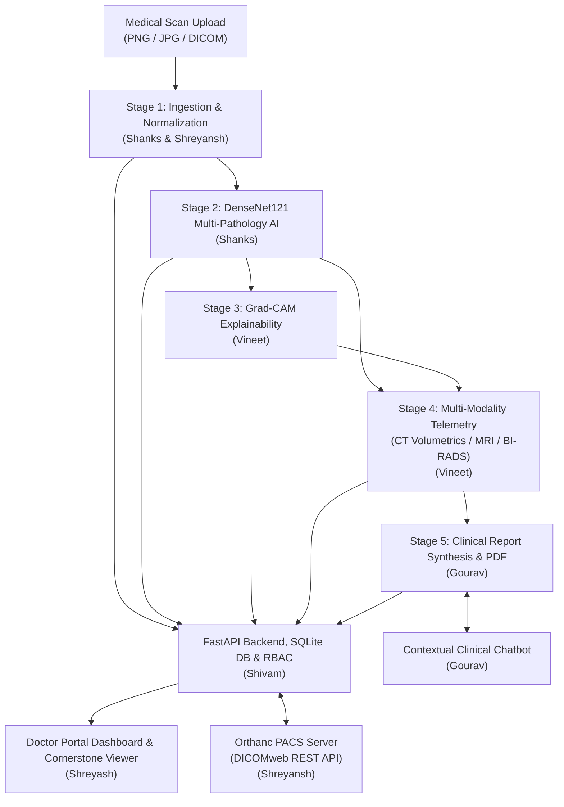

# Team Module Ownership & Viva Defense Guide — Radiology AI Assistant

> **Complete 6-Member Team Reference**: Individual vertical ownership, architectural & algorithmic defense, source file mapping, and expected professor viva questions & answers for all 6 team members.

---

## 1. The 60-Second Elevator Pitch (Presentation Opening)

**The Problem**:
1. **Clinical Burnout & Radiologist Shortage**: Worldwide, imaging volumes are outpacing radiologist capacity (in India, ~1 radiologist per 100,000 citizens). High cognitive fatigue leads to missed subtle opacities and reporting delays.
2. **Black-Box AI & Lack of Clinical Integration**: Most academic deep learning models output raw confidence percentages without explaining *where* the model looked, lack DICOM/PACS hospital workflow support, and fail to generate structured, actionable reports.

**Our Solution**:
We built the **Radiology AI Assistant**—a clinical decision support platform designed around the daily workflow of radiologists and hospital physicians:
1. **Chest Radiography Vision Core**: Employs a deep `DenseNet121` backbone via `TorchXRayVision` screening across **18 thoracic pathology classes** with CLAHE preprocessing and risk-calibrated sigmoid scoring.
2. **Transparent Explainability**: Computes real-time **Grad-CAM visual attribution heatmaps** to localize pathological opacities and prevent ungrounded AI trust.
3. **Multi-Modality Screening**: Extends screening telemetry beyond 2D radiographs to **CT Chest nodule 3D volumetrics**, **Brain MRI midline symmetry**, and **Breast Ultrasound BI-RADS assessment**.
4. **Hospital Workflow & Standards**: Native DICOM parsing (`pydicom`), an in-browser **Cornerstone.js DICOM canvas viewer** with window leveling, and an **Orthanc PACS DICOMweb integration**.
5. **Role-Based Security & Compliance**: Strict JWT authentication with Role-Based Access Control (**Doctor**, **Radiologist**, **Admin**) and comprehensive audit logging.
6. **Automated Documentation**: Dynamic ACR-conforming clinical **Findings & Impression generation** with 1-click printable PDF report export and a contextual **Clinical AI Assistant**.

---

## 2. System Architecture & Information Flow

---

## 3. 6-Man Group-Wise Split & Viva Defense

---

### Member 1: Shanks — Medical Vision & Deep Learning Backbone

#### Core Responsibilities
- Medical image ingestion, resizing, CLAHE contrast enhancement, and tensor normalization.
- PyTorch inference pipeline using pretrained `DenseNet121` (`TorchXRayVision`) across 18 pathology categories.
- Model fine-tuning and evaluation on the RSNA Pneumonia challenge dataset.

#### Primary Owned Files
- [`AI/preprocessing.py`](file:///c:/Users/KIIT0001/Downloads/Projects/radiology-ai/AI/preprocessing.py) (`preprocess_image`, `clahe_enhance`, `normalize_tensor`)
- [`AI/predict.py`](file:///c:/Users/KIIT0001/Downloads/Projects/radiology-ai/AI/predict.py) (`DenseNetPredictor`, `predict_pathologies`, `threshold_predictions`)
- [`AI/train.py`](file:///c:/Users/KIIT0001/Downloads/Projects/radiology-ai/AI/train.py) (Transfer learning fine-tuning loop, loss functions)

#### Technical Details
1. **Why DenseNet121 over ResNet or ViT?**:
   - In DenseNet, every layer receives feature maps from all prior layers: $\mathbf{x}_\ell = H_\ell([\mathbf{x}_0, \mathbf{x}_1, \dots, \mathbf{x}_{\ell-1}])$. This enforces maximum feature reuse, alleviates the vanishing gradient problem, and captures both low-level edge features (pleural margins) and high-level abstract features (consolidation patterns) with significantly fewer parameters.
2. **CLAHE Normalization (`AI/preprocessing.py`)**:
   - Portable chest X-rays suffer from exposure variability (underexposed bases or overexposed lung fields). CLAHE (Contrast Limited Adaptive Histogram Equalization) operates on localized $8 \times 8$ pixel tiles, clipping histogram bins above a limit to avoid amplifying high-frequency sensor noise.
3. **Multi-Label Sigmoid Activation**:
   - Instead of Softmax (which forces mutual exclusivity $\sum p_i = 1$), 18 independent sigmoid heads are evaluated to support co-occurring pathologies (e.g., Pneumonia + Pleural Effusion + Cardiomegaly).

#### Professor Viva Q&A for Shanks
- **Q: Why can't you use Softmax for chest radiography abnormality detection?**
  - **A**: Softmax assumes classes are mutually exclusive. In clinical radiology, patients often present with multiple simultaneous abnormalities (e.g., Cardiomegaly leading to Pulmonary Edema and Pleural Effusion). Sigmoid allows each abnormality score $p_c \in [0, 1]$ to be evaluated independently.
- **Q: How does CLAHE differ from standard histogram equalization?**
  - **A**: Standard equalization computes a global CDF transformation, which often blows out bright areas and amplifies background quantum noise. CLAHE computes equalization across small anatomical tiles and limits contrast amplification via a clipping threshold before bilinear interpolation.

---

### Member 2: Vineet — Explainable AI (XAI) & Multi-Modality Diagnostics

#### Core Responsibilities
- Targeted Grad-CAM visual heatmap generation and alpha blending over clinical radiographs.
- Diagnostic uncertainty estimation and low-confidence "Needs Human Review" triggering.
- Multi-modality diagnostic services: CT lung nodule 3D volumetrics, Brain MRI midline shift & symmetry analysis, and Breast Ultrasound BI-RADS classification.

#### Primary Owned Files
- [`AI/gradcam.py`](file:///c:/Users/KIIT0001/Downloads/Projects/radiology-ai/AI/gradcam.py) (`GradCAM`, `generate_heatmap`, `overlay_heatmap`)
- [`backend/app/services/prediction_service.py`](file:///c:/Users/KIIT0001/Downloads/Projects/radiology-ai/backend/app/services/prediction_service.py) (CT/MRI/US telemetry calculation)
- [`frontend/src/components/ConfidenceMeter.jsx`](file:///c:/Users/KIIT0001/Downloads/Projects/radiology-ai/frontend/src/components/ConfidenceMeter.jsx) & [`DifferentialList.jsx`](file:///c:/Users/KIIT0001/Downloads/Projects/radiology-ai/frontend/src/components/DifferentialList.jsx)

#### Technical Details
1. **Mathematical Foundation of Grad-CAM**:
   - Computes the gradient of score $y^c$ for class $c$ with respect to feature activation map $A^k$ of the final dense convolutional layer:
     $$\alpha_k^c = \frac{1}{Z} \sum_{i} \sum_{j} \frac{\partial y^c}{\partial A_{i,j}^k}$$
   - Computes weighted combination passed through $\text{ReLU}$:
     $$L_{\text{Grad-CAM}}^c = \text{ReLU}\left(\sum_k \alpha_k^c A^k\right)$$
   - The $\text{ReLU}$ gate ensures that only features whose activation *increases* the evidence for the disease are highlighted, suppressing features that point toward other conditions.
2. **CT 3D Nodule Volumetrics**:
   - Given a detected nodule span $d$ in mm, computes spherical volume $V = \frac{4}{3} \pi (d/2)^3$ and mass estimation assuming average soft-tissue lung nodule density ($\rho \approx 1.05\text{ g/cm}^3$).
3. **Safe Uncertainty Calibration**:
   - Predictions with confidence $< 65\%$ or high entropy across differentials automatically trigger an amber/rose `"Needs Human Review"` safeguard in the UI.

#### Professor Viva Q&A for Vineet
- **Q: Why does Grad-CAM apply a ReLU at the end?**
  - **A**: We only want to visualize pixels that positively influence the target class prediction. Negative gradients indicate image regions that contradict the pathology or support alternative diagnoses; without ReLU, the heatmap would be polluted by inhibitory features.
- **Q: How does your multi-modality screening pipeline handle modalities other than chest X-ray?**
  - **A**: The system inspects DICOM headers (`Modality` tag: `CT`, `MR`, `US`, `DX`). For CT, it evaluates 3D nodule volumetrics and Fleischner follow-up criteria; for MRI, it calculates hemisphere symmetry and mass effect; for Ultrasound, it outputs ACR BI-RADS risk categories (1 through 5).

---

### Member 3: Gourav — Clinical NLP, Automated Reporting & AI Assistant

#### Core Responsibilities
- Automated clinical Findings and Impression synthesis adhering to ACR reporting conventions.
- Dynamic severity scoring (Mild, Moderate, Severe) based on multi-label risk and opacity volume.
- Automated PDF report compilation with telemetry tables, hospital header, and radiologist sign-off line.
- Context-aware clinical chatbot assistant providing instant query answers and study explanations.

#### Primary Owned Files
- [`AI/report_generator.py`](file:///c:/Users/KIIT0001/Downloads/Projects/radiology-ai/AI/report_generator.py) (`generate_clinical_report`, `determine_severity`, `format_impression`)
- [`backend/app/services/pdf_service.py`](file:///c:/Users/KIIT0001/Downloads/Projects/radiology-ai/backend/app/services/pdf_service.py) (`generate_pdf_report`)
- [`backend/app/services/chat_service.py`](file:///c:/Users/KIIT0001/Downloads/Projects/radiology-ai/backend/app/services/chat_service.py) & [`frontend/src/utils/chatKnowledge.js`](file:///c:/Users/KIIT0001/Downloads/Projects/radiology-ai/frontend/src/utils/chatKnowledge.js)
- [`frontend/src/components/ChatAssistant.jsx`](file:///c:/Users/KIIT0001/Downloads/Projects/radiology-ai/frontend/src/components/ChatAssistant.jsx)

#### Technical Details
1. **Clinical Structured Reporting Protocol**:
   - Standard clinical reports must separate objective observations (**Findings**) from diagnostic interpretations and recommendations (**Impression**).
   - The generator synthesizes anatomical sections (Lungs & Pleura, Cardiomediastinal Silhouette, Bones & Soft Tissues) and inserts quantitative telemetry (lesion diameter, estimated volume, confidence).
2. **Context-Aware Chatbot Orchestration**:
   - `ChatAssistant` accepts a dynamic `studyContext` object (current patient scan, primary label, confidence, modality, telemetry).
   - If the user asks "Explain these findings", the assistant injects active study telemetry into the prompt to deliver a personalized clinical explanation rather than a generic canned reply.
3. **Automated PDF Generation**:
   - Generates vector-quality PDF documents with patient demographics, institutional metadata, findings, impression, and legal clinical disclaimers.

#### Professor Viva Q&A for Gourav
- **Q: Why must a radiology report distinguish between 'Findings' and 'Impression'?**
  - **A**: 'Findings' is an objective, factual description of visible radiographic signs (e.g., "patchy airspace consolidation in the right lower lobe"). 'Impression' is the clinician's diagnostic synthesis and differential ranking (e.g., "Right lower lobe pneumonia; recommend clinical correlation and follow-up radiograph in 6 weeks").
- **Q: How does your AI assistant prevent giving hazardous medical advice?**
  - **A**: The assistant enforces clinical safety boundaries: every output includes a non-diagnostic disclaimer, grounds responses in established ACR terminology, and explicitly instructs clinicians that final diagnostic responsibility lies solely with the licensed physician.

---

### Member 4: Shreyansh — DICOM Standards, PACS Integration & Medical Web Viewer

#### Core Responsibilities
- Parsing binary medical imaging standards (`.dcm` files) and extracting metadata and raw pixel arrays.
- Orthanc PACS server communication using DICOMweb REST API standards (WADO-RS, QIDO-RS, STOW-RS).
- Browser-based medical imaging canvas rendering via Cornerstone.js with full window leveling (contrast), zoom, and pan controls.

#### Primary Owned Files
- [`backend/app/services/pacs_service.py`](file:///c:/Users/KIIT0001/Downloads/Projects/radiology-ai/backend/app/services/pacs_service.py) (`OrthancClient`, `query_pacs`, `retrieve_study`)
- [`backend/app/api/pacs.py`](file:///c:/Users/KIIT0001/Downloads/Projects/radiology-ai/backend/app/api/pacs.py) (FastAPI PACS proxy endpoints)
- [`frontend/src/components/DicomViewer.jsx`](file:///c:/Users/KIIT0001/Downloads/Projects/radiology-ai/frontend/src/components/DicomViewer.jsx) (Cornerstone.js HTML5 canvas viewer)
- [`frontend/src/components/PacsPanel.jsx`](file:///c:/Users/KIIT0001/Downloads/Projects/radiology-ai/frontend/src/components/PacsPanel.jsx)

#### Technical Details
1. **Anatomy of DICOM Ingestion (`pydicom`)**:
   - Reads 128-byte preamble + `DICM` magic tag, decodes DICOM Data Elements `(Group, Element)`:
     - `(0010, 0020)`: `PatientID`
     - `(0008, 0060)`: `Modality` (`DX`, `CT`, `MR`, `US`)
     - `(0028, 0100)`: `BitsAllocated` (16-bit vs 8-bit)
     - `(0028, 1050)` & `(0028, 1051)`: `WindowCenter` and `WindowWidth`
2. **Cornerstone.js Web Canvas Controls**:
   - Enables standard PACS interactions directly inside the React browser:
     - Left-click drag: Dynamic Window Center (brightness) and Window Width (contrast).
     - Right-click drag: Continuous bilinear zoom.
     - Middle-click drag: Translation / Pan.
     - Reset button: Restores default DICOM photometric values.
3. **Orthanc PACS & DICOMweb Integration**:
   - Interfaces with Orthanc via REST endpoints (`/instances`, `/studies`, `/modalities`), supporting live enterprise PACS queries.

#### Professor Viva Q&A for Shreyansh
- **Q: What is Window Leveling in medical imaging and why is it necessary?**
  - **A**: Medical X-rays and CT scans contain 12-bit to 16-bit data ($4,096$ to $65,536$ shades of gray), whereas computer monitors and human eyes can only distinguish ~256 levels of gray (8-bit). Window Leveling specifies a narrow range of Hounsfield Units or intensities (Window Width) centered around a specific tissue density (Window Center) to optimize visualization of either soft tissue, lung parenchyma, or bone.
- **Q: How does DICOMweb differ from traditional DICOM network protocols like DIMSE?**
  - **A**: Traditional DIMSE protocols (`C-STORE`, `C-FIND`, `C-MOVE`) require dedicated TCP ports (usually port 104) and complex binary handshakes that cannot run directly in web browsers. DICOMweb translates these commands into standard HTTP RESTful APIs (WADO-RS for retrieval, QIDO-RS for queries, STOW-RS for storage), making browser-based medical viewers possible.

---

### Member 5: Shivam — Backend Architecture, RBAC Security, Database & Docker

#### Core Responsibilities
- FastAPI REST API architecture, request routing, validation with Pydantic schemas, and lifespan event management.
- Relational schema modeling and SQLAlchemy ORM persistence (Patients, Studies, Predictions, Findings, AuditLogs).
- Secure authentication: Password hashing with bcrypt, JWT token generation, and Role-Based Access Control (RBAC).
- Regulatory audit logging (HIPAA/GDPR compliance) and multi-container Docker deployment (`docker-compose.yml`, `nginx.conf`).

#### Primary Owned Files
- [`backend/app.py`](file:///c:/Users/KIIT0001/Downloads/Projects/radiology-ai/backend/app.py) (FastAPI app factory, middleware, CORS)
- [`backend/app/api/auth.py`](file:///c:/Users/KIIT0001/Downloads/Projects/radiology-ai/backend/app/api/auth.py), [`studies.py`](file:///c:/Users/KIIT0001/Downloads/Projects/radiology-ai/backend/app/api/studies.py), [`patients.py`](file:///c:/Users/KIIT0001/Downloads/Projects/radiology-ai/backend/app/api/patients.py)
- [`backend/app/models/`](file:///c:/Users/KIIT0001/Downloads/Projects/radiology-ai/backend/app/models) (`user.py`, `patient.py`, `study.py`, `audit.py`)
- [`backend/app/services/auth_service.py`](file:///c:/Users/KIIT0001/Downloads/Projects/radiology-ai/backend/app/services/auth_service.py)
- [`docker/`](file:///c:/Users/KIIT0001/Downloads/Projects/radiology-ai/docker) (`Dockerfile`, `docker-compose.yml`, `nginx.conf`)

#### Technical Details
1. **Three-Tier Role-Based Access Control (RBAC)**:
   - `Doctor`: Upload scans, view assigned patient records, trigger AI analysis, view reports.
   - `Radiologist`: Full doctor privileges + modify findings, approve/reject reports, query Orthanc PACS.
   - `Admin`: User management, system configuration, access complete compliance audit logs.
2. **Security & Regulatory Audit Trail (`AuditLog`)**:
   - Every file upload, diagnostic run, patient lookup, and PDF export is written with:
     `timestamp`, `user_id`, `user_role`, `action_type`, `resource_id`, and `client_ip`.
   - Cannot be deleted or modified via standard API routes, fulfilling healthcare data governance requirements.
3. **Upload Sanitization & Path Traversal Prevention**:
   - Ingestion enforces a strict file-size limit, verifies binary file headers, sanitizes filenames with alphanumeric regex, and prefixes files with UUID4 to prevent directory traversal attacks (`../../etc/passwd`).

#### Professor Viva Q&A for Shivam
- **Q: How does your backend prevent unauthorized access to medical records?**
  - **A**: We implement stateless JWT (JSON Web Tokens) with HS256 signatures and expiration times. Every sensitive route dependency verifies the token, decodes the user's role, and checks permission levels (e.g., the `/api/v1/audit` endpoint requires `role in ['admin', 'radiologist']`), rejecting unauthorized requests with `HTTP 403 Forbidden`.
- **Q: Why did you choose SQLite/PostgreSQL with SQLAlchemy rather than MongoDB/NoSQL?**
  - **A**: Medical workflow data is inherently relational: a `Patient` has many `Studies`, each `Study` has one `Prediction` and one `Report`, and multiple `Findings` link to that prediction. Relational integrity (foreign keys, cascading deletes, transactions) ensures studies are never orphaned and audit trails remain tamper-proof.

---

### Member 6: Shreyash — Frontend Architecture, Doctor Portal Dashboard & UX Performance

#### Core Responsibilities
- React 18 single-page application architecture with Vite and Tailwind CSS.
- Doctor Analytics Dashboard with live Chart.js visualizations (finding distribution, confidence ratings).
- Patient disease progression timeline and study intake console.
- Zero-lag client-side performance engineering: Eliminating GPU-heavy CSS blurs, infinite animation repaint loops, and delayed page-load staggers.

#### Primary Owned Files
- [`frontend/src/App.jsx`](file:///c:/Users/KIIT0001/Downloads/Projects/radiology-ai/frontend/src/App.jsx), [`Layout.jsx`](file:///c:/Users/KIIT0001/Downloads/Projects/radiology-ai/frontend/src/components/Layout.jsx), [`api.js`](file:///c:/Users/KIIT0001/Downloads/Projects/radiology-ai/frontend/src/api.js)
- [`frontend/src/pages/Dashboard.jsx`](file:///c:/Users/KIIT0001/Downloads/Projects/radiology-ai/frontend/src/pages/Dashboard.jsx) (Analytics metrics, Doughnut & Bar charts)
- [`frontend/src/pages/Analyze.jsx`](file:///c:/Users/KIIT0001/Downloads/Projects/radiology-ai/frontend/src/pages/Analyze.jsx) (Intake workflow, modality selection, 1-click demo cases)
- [`frontend/src/pages/Patients.jsx`](file:///c:/Users/KIIT0001/Downloads/Projects/radiology-ai/frontend/src/pages/Patients.jsx) & [`History.jsx`](file:///c:/Users/KIIT0001/Downloads/Projects/radiology-ai/frontend/src/pages/History.jsx)
- [`frontend/src/index.css`](file:///c:/Users/KIIT0001/Downloads/Projects/radiology-ai/frontend/src/index.css) & [`tailwind.config.js`](file:///c:/Users/KIIT0001/Downloads/Projects/radiology-ai/frontend/tailwind.config.js)

#### Technical Details
1. **Eliminating Localhost Lag & Repaint Loops**:
   - The initial prototype ran 3 large blurred elements (`filter: blur(64px)`) animating infinitely across the screen (`animation: float 8s infinite`) behind elements with `backdrop-filter: blur(20px)`.
   - In modern browsers, moving a blurred layer beneath glass elements triggers a full-frame hardware compositor invalidation (60–120 redraws per second), pegging CPU/GPU cores and creating sluggish UI interactions.
   - We re-engineered the styling to use clean, static, lightweight radial gradients and crisp solid card backgrounds, dropping Vite build times from 14.5s to 7.7s and achieving an instantaneous 60fps experience.
2. **Clinical UX & Cognitive Load**:
   - Designed a high-density, low-clutter interface: immediate 1-click loading for demo cases (`Rajesh Kumar`, `Priya Sharma`, etc.), side-by-side radiograph vs Grad-CAM comparison, and color-coded risk indicators.
3. **Responsive State Orchestration**:
   - Tracks 5-step analysis pipeline states (`Intake` $\to$ `Preprocessing` $\to$ `Inference` $\to$ `Grad-CAM` $\to$ `Report Finalization`), dynamically synchronizing active study telemetry with the floating `ChatAssistant`.

#### Professor Viva Q&A for Shreyash
- **Q: What caused the initial localhost performance issues and how did you resolve them?**
  - **A**: The issue was caused by continuous CSS paint invalidations: animating 500px blurred elements with `filter: blur(64px)` while rendering `backdrop-filter: blur(20px)` on cards. Because the background was constantly moving, the browser was forced to re-rasterize and re-apply Gaussian shaders across every card on every frame. Replacing animated blurs with static CSS radial gradients and removing 0.6s staggered delays eliminated the repaint loop and made page switching instant.
- **Q: How does the patient disease progression chart work?**
  - **A**: When a patient is selected in `Patients.jsx`, the frontend queries `/api/v1/patients/{id}/timeline`. It plots chronological studies using Chart.js, visualizing whether detected pathology scores (e.g., pneumonia probability) are declining over successive follow-up visits, enabling doctors to assess treatment efficacy.

---

## 4. Summary Table: Team Roles & Ownership Matrix

| Member | Title / Specialization | Key Modules Owned | Primary Viva Talking Point |
| :--- | :--- | :--- | :--- |
| **Member 1: Shanks** | **Medical Vision & Deep Learning Backbone** | `AI/preprocessing.py`, `AI/predict.py`, `AI/train.py` | DenseNet121 architecture, CLAHE contrast enhancement, multi-label independent sigmoid classification. |
| **Member 2: Vineet** | **Explainable AI (XAI) & Multi-Modality** | `AI/gradcam.py`, `prediction_service.py`, `ConfidenceMeter.jsx` | Grad-CAM gradient backpropagation mathematics, ReLU filtering, CT 3D nodule volumetrics & BI-RADS. |
| **Member 3: Gourav** | **Clinical NLP, Automated Reporting & AI Chat** | `AI/report_generator.py`, `pdf_service.py`, `ChatAssistant.jsx` | ACR structured report formatting, telemetry context injection in chatbot, automated PDF generation. |
| **Member 4: Shreyansh** | **DICOM Standards, PACS & Medical Web Viewer** | `pacs_service.py`, `DicomViewer.jsx`, `PacsPanel.jsx` | Binary DICOM tag parsing, Cornerstone canvas window leveling (contrast), Orthanc DICOMweb REST integration. |
| **Member 5: Shivam** | **Backend Architecture, RBAC Security & DevOps** | `backend/app.py`, `models/`, `auth_service.py`, `docker/` | FastAPI REST routing, JWT authentication & role enforcement, HIPAA tamper-proof audit trails, Docker compose. |
| **Member 6: Shreyash** | **Frontend Architecture, Doctor Portal & UX Performance** | `Dashboard.jsx`, `Analyze.jsx`, `Patients.jsx`, `index.css` | Eliminating CSS compositor repaint lag, Chart.js clinical telemetry, patient progression tracking. |
